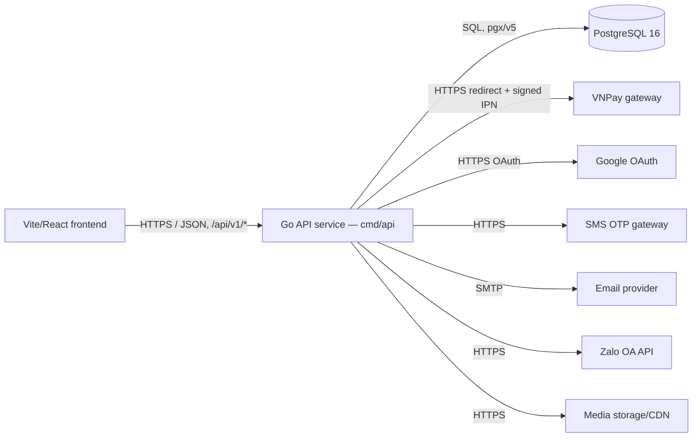

# Service & Interface Design — Nghệ An Departures

Last updated: 2026-11-01
Source: `docs/account/SRS.md`, `docs/admin/SRS.md`, `docs/auth/SRS.md`,
`docs/booking/SRS.md`, `docs/contact/SRS.md`, `docs/data/SRS.md`,
`docs/notifications/SRS.md`, `docs/payments/SRS.md`, `docs/search/SRS.md`,
`docs/site/SRS.md`, `docs/suppliers/SRS.md`, `docs/architecture/erd.md`

## 1. Service map



| Service | Responsibility | Owns (tables) | Depends on | Deploy unit |
|---|---|---|---|---|
| API (Go, `cmd/api`) | Every read and write in this project: public data reads, auth/sessions, booking + inventory hold, payments, suppliers, admin, search, contact forwarding, notifications | `users`, `sessions`, `otp_codes`, `suppliers`, `products`, `departures`, `destinations`, `categories`, `guides`, `reviews`, `bookings`, `payments`, `vouchers`, `payouts`, `complaints`, `campaigns`, `audit`, `notifications`, `settings`, `wishlists` | PostgreSQL, VNPay, Google OAuth, SMS gateway, SMTP, Zalo OA, media storage | one container |

**Why these boundaries** — single service: no boundary justified yet. One
Go binary owns every table; there is no difference in ownership, scaling,
or deploy cadence between, say, `booking` and `suppliers` that would
justify a network hop. Each SRS module below maps to an internal Go
package (`internal/auth`, `internal/booking`, `internal/suppliers`, …),
not a separate deploy. The frontend is the only other service, and it
calls this one over HTTP exactly as a second backend service would — so
nothing here is lost if a seam is ever cut later; the contract below
would just move with whichever package it splits off.

## 2. Cross-cutting contract

### 2.1 Base

- Base URL: the backend mounts every route at `/v1/...` — no `/api`
  prefix in this service's own router. The edge proxy adds and strips
  `/api`, so the browser calls `/api/v1/...` and this document describes
  the path exactly as `cmd/api` registers it.
- Content type: `application/json; charset=utf-8` for every request and
  response body except `POST /v1/media` (`multipart/form-data`) and the
  VNPay return/IPN endpoints (`application/x-www-form-urlencoded` query
  parameters, per VNPay's own integration, §3.9).
- Versioning: URL path major version (`/v1`). A new major version only
  for a breaking change; this project ships one version for its whole
  MVP.
- Trace header: `X-Request-Id` accepted from the caller, generated if
  absent, echoed on every response and present in every log line.

### 2.2 Authentication and authorization

| Aspect | Decision |
|---|---|
| Mechanism | Opaque session token (random 32-byte value), stored server-side in `sessions.token_hash` (SHA-256 of the raw token) |
| Token lifetime | `sessions.expires_at` = issued_at + 30 days |
| Refresh | None — a token is reissued by signing in again; there is no silent refresh endpoint in this MVP |
| Transport | `Authorization: Bearer <token>`; the frontend also sets it as an HTTP-only cookie `session` on the same response so a page reload resends it automatically (AUTH-004 AC-1) — the server accepts either the header or the cookie, header taking precedence when both are sent |
| Roles | `buyer`, `supplier`, `admin` (a sub-admin is `role = 'admin'` with a non-null `permissions` value naming its restricted set, e.g. `moderation-only`, `finance-only`) |
| Enforcement point | Middleware resolves the token to a `users` row on every request and attaches `{user_id, role, permissions}` to the request context; each handler then authorizes per-resource against that context (never against a client-supplied field) |

A `permissions` value is one of a closed set:
`moderation-only`, `finance-only`, `content-only`, `full` (an admin with
no restriction — the default when `permissions` is null and `role =
'admin'`). An endpoint under `/v1/admin/*` lists in its own section which
`permissions` value(s) it accepts.

### 2.3 Error contract

Every non-2xx response, from every endpoint **except** the VNPay
return/IPN endpoints (§3.9, which answer in VNPay's own shape by
contract), has this shape:

```json
{
  "error": {
    "code": "VALIDATION_FAILED",
    "message": "Human-readable summary, safe to show a user.",
    "details": [
      { "field": "email", "code": "INVALID_FORMAT", "message": "..." }
    ],
    "request_id": "01HX…"
  }
}
```

Consumers branch on `code`. `message` is display text and may be reworded
at any time without notice — it is not part of the contract. `details` is
present only for `VALIDATION_FAILED` and `MALFORMED_REQUEST`; omitted
otherwise.

**Error catalog** — the full closed set for this project.

| Code | HTTP | Meaning | Retryable |
|---|---|---|---|
| `MALFORMED_REQUEST` | 400 | Body is not valid JSON, a field has the wrong type, or the body carries a field this contract does not define | no |
| `VALIDATION_FAILED` | 422 | Well-formed request whose values break a rule — length, range, format, blank, out-of-set enum | no |
| `UNAUTHENTICATED` | 401 | Missing, invalid, expired or revoked session token | no |
| `PERMISSION_DENIED` | 403 | Authenticated but the resolved role/permissions do not allow this action | no |
| `NOT_FOUND` | 404 | Resource does not exist, or exists but is not visible to this caller | no |
| `CONFLICT` | 409 | Violates a uniqueness or state invariant (duplicate email, seats no longer available, voucher already applied, duplicate open complaint, locking the last admin) | no |
| `RATE_LIMITED` | 429 | Too many requests (OTP resend, sign-in attempts) — honor `Retry-After` | yes |
| `INTERNAL` | 500 | Unexpected failure, including a query or insert that failed; details are logged, not returned | yes |
| `UNAVAILABLE` | 503 | A dependency (database, VNPay, SMS gateway, SMTP, Zalo, media storage) refused the connection, or the process is shutting down | yes |

### 2.4 Pagination

Cursor pagination for `bookings`, `audit`, `notifications`, `reviews` and
any list that grows continuously; offset pagination for the `data`
module's generic collection reads, matching DATA-002's own
`page`/`limit`/`total` shape (a fixed, bounded set of seed collections,
never written at a rate that makes offset drift matter).

**`data` module generic list — offset style (DATA-002):**

```
GET /v1/<collection>?page=1&limit=12&<field>=<value>
```

```json
{ "items": [ … ], "total": 57, "page": 1, "limit": 12 }
```

**Every other list in this document — cursor style:**

```
GET /v1/bookings?limit=50&cursor=eyJpZCI6…
```

```json
{ "data": [ … ], "next_cursor": "eyJpZCI6…", "has_more": true }
```

| Aspect | Decision |
|---|---|
| Style | offset for `/v1/<collection>` generic reads (DATA-002); cursor for every module-specific list endpoint below |
| Default limit | 12 for `/v1/<collection>` (DATA-002.3); 20 for every cursor-paginated endpoint |
| Max limit | 100 for both styles |
| Over the max limit | rejected with `VALIDATION_FAILED`, never clamped |
| Default sort | `/v1/<collection>`: seed insertion order (`created_at, id`); cursor endpoints: `created_at DESC, id DESC` unless the endpoint states otherwise — both unique and stable |

### 2.5 Validation boundary

Validation happens once, at the HTTP handler, before any service/
repository function is called. A request field the contract does not
define is rejected with `400 MALFORMED_REQUEST` — never accepted and
silently ignored, including an unknown JSON field, an unknown query
parameter on a non-`data`-module endpoint, and an unrecognized
multipart field. (DATA-002 is the one documented exception: an unknown
*filter* query parameter on `/v1/<collection>` is ignored per DATA-002's
own "ignored, does not error" rule — every other endpoint in this
document follows the strict rule.) Below the handler, repository and
business-logic code trusts its inputs and never re-validates defensively.

### 2.6 Idempotency

| Endpoint | Key | Retention | Replay behavior |
|---|---|---|---|
| `POST /v1/bookings` | None — BOOKING-001's own atomic seat decrement is the safety net; a resubmit with the same form values creates a second booking attempt against current seat availability, which is the intended "try again" behavior | — | — |
| `POST /v1/bookings/{id}/checkout/vnpay` | `Idempotency-Key` header, required | 24h | A replay with the same key and the same booking returns the original `payments` row's redirect URL instead of creating a second `pending` row |
| `POST /v1/payments/vnpay/ipn` | VNPay's own `vnp_TxnRef` + `vnp_TransactionNo`, matched against `payments.gateway_transaction_id` (PAYMENTS-001 AC-4) | — | A second callback for an already-`succeeded`/`failed` row is accepted (200) and changes nothing |
| `POST /v1/bookings/{id}/voucher` | None — BOOKING-002.4/AC-5 is enforced by `vouchers.used` incrementing at most once per booking, checked via a `booking_id` the server already holds, not a client-supplied key | — | — |
| `POST /v1/media` | None — each call stores a new file; a retry after a network failure may store a second file, which the calling form simply replaces its reference to | — | — |


## 3. Endpoints

Grouped by owning SRS module. Every endpoint uses the error contract and
pagination scheme in §2 unless stated otherwise.

### 3.1 `data` module — generic collection reads

**Traces to:** DATA-002, DATA-003. **Auth:** none (public read).

#### 3.1.1 `GET /v1/{collection}`

**Purpose** — page through any seeded collection, optionally filtered.

**Path / query parameters**

| Name | In | Type | Required | Constraints | Description |
|---|---|---|---|---|---|
| `collection` | path | string | yes | one of: `products`, `destinations`, `categories`, `departures`, `guides`, `reviews`, `suppliers`, `bookings`, `payouts`, `users`, `vouchers`, `campaigns`, `complaints`, `audit`, `notifications`, `settings` | which table to read |
| `page` | query | integer | no, default 1 | ≥ 1 | 1-based page number |
| `limit` | query | integer | no, default 12 | 1–100 | page size |
| `<field>` | query | string | no | must name a real column on that collection | exact-match filter; a name that matches no column is **ignored** (DATA-002's own documented exception to §2.5) |

**Success response** — `200`

```json
{ "items": [ { "...": "..." } ], "total": 57, "page": 1, "limit": 12 }
```

**Errors**

| Code | HTTP | Trigger |
|---|---|---|
| `NOT_FOUND` | 404 | `collection` does not match one of the sixteen names above |
| `VALIDATION_FAILED` | 422 | `limit` > 100, `page` < 1, or `limit`/`page` not a positive integer |

**Notes** — `bookings`, `users`, `audit` are reachable here too, with every
column visible, because this module deliberately has "no role
distinctions of its own" (SRS §2); that is intentional for MVP per the
SRS but is flagged again in §9 as a privacy-sensitive default worth the
stakeholder's sign-off, since `GET /v1/users` through this generic reader
would otherwise expose `password_hash`-adjacent rows to anyone. **Decision
taken here:** `users`, `sessions`, `otp_codes`, `payments` are excluded
from the `collection` enum above and from this endpoint entirely —
DATA-001 names `users` as a seeded collection but the generic reader never
serves it; a caller needing user data uses the `admin` module's own
scoped endpoints (§3.8), which apply RBAC. This is additive to DATA-002's
letter (removing one collection from a public reader, never widening
access) and is the one place this document narrows an SRS requirement for
a security reason — recorded as a deviation per the api-conventions
cover note.

#### 3.1.2 `GET /v1/{collection}/{id}`

**Purpose** — read one record by id. **Auth** — none, same collection
enum and `users` exclusion as 3.1.1.

**Path parameters**

| Name | In | Type | Required | Constraints | Description |
|---|---|---|---|---|---|
| `collection` | path | string | yes | same enum as 3.1.1 | |
| `id` | path | string (uuid) | yes | — | |

**Success response** — `200` — the record, every column of that table.

**Errors**

| Code | HTTP | Trigger |
|---|---|---|
| `NOT_FOUND` | 404 | `collection` not in the enum, or no row with that `id` |

### 3.2 `auth` module

**Traces to:** AUTH-001 to AUTH-004. **Depends on:** Google OAuth
(`GOOGLE_OAUTH_CLIENT_ID`/`_SECRET`), SMS gateway (`SMS_OTP_API_KEY`).

#### 3.2.1 `POST /v1/auth/register`

**Purpose** — AUTH-001.1, email+password sign-up. **Auth** — none.

**Request body**

```json
{ "email": "a@x.com", "password": "********", "name": "Nguyễn Văn A", "role": "buyer" }
```

| Field | Type | Required | Constraints | Description |
|---|---|---|---|---|
| `email` | string | yes | valid email shape, unique in `users` | |
| `password` | string | yes | 8–72 chars | hashed server-side (bcrypt), never stored or logged plaintext |
| `name` | string | yes | 1–120 chars | |
| `role` | string | yes | `buyer` or `supplier` (`admin` is never self-registered — created only via 3.8.6) | |

**Success response** — `201`, `Location: /v1/auth/me`

```json
{ "user": { "id": "...", "email": "a@x.com", "name": "...", "role": "buyer", "status": "Active" }, "token": "..." }
```

| Field | Type | Nullable | Description |
|---|---|---|---|
| `user.status` | string | no | `Active`, or `Awaiting documents` when `role = 'supplier'` |
| `token` | string | no | opaque session token; also set as the `session` cookie |

**Errors**

| Code | HTTP | Trigger |
|---|---|---|
| `VALIDATION_FAILED` | 422 | email not a valid shape, password out of length range, role not one of the two allowed, name blank |
| `CONFLICT` | 409 | email already exists in `users` (AUTH-001 AC-2) |

#### 3.2.2 `POST /v1/auth/login`

**Purpose** — AUTH-001.2–5, email+password sign-in. **Auth** — none.

**Request body** — `{ "email": "...", "password": "..." }`, both required.

**Success response** — `200` — same shape as 3.2.1's success body.

**Errors**

| Code | HTTP | Trigger |
|---|---|---|
| `VALIDATION_FAILED` | 422 | either field blank or email not a valid shape |
| `UNAUTHENTICATED` | 401 | no row for that email, or the password hash does not match — **one message, one code, for both** (AUTH-001 AC-4/AC-5: "does not reveal which of the two was wrong") |
| `PERMISSION_DENIED` | 403 | the row's `status = 'Locked'` (AUTH-001 AC-6) — distinct from the 401 above because the message must name the account as locked, not imply a wrong password |

#### 3.2.3 `POST /v1/auth/otp/request`

**Purpose** — AUTH-002.1, request a phone OTP. **Auth** — none.

**Request body** — `{ "phone": "+84..." }`, required, E.164 shape.

**Success response** — `202`, `{}` (the code is sent out-of-band; never
returned in this body).

**Errors**

| Code | HTTP | Trigger |
|---|---|---|
| `VALIDATION_FAILED` | 422 | phone not a valid shape |
| `RATE_LIMITED` | 429 | more than 3 requests for the same phone in 10 minutes (AUTH-002's "requested repeatedly in a short window") |
| `UNAVAILABLE` | 503 | the SMS gateway rejects the connection |

#### 3.2.4 `POST /v1/auth/otp/verify`

**Purpose** — AUTH-002.2–3, verify a phone OTP and sign in. **Auth** — none.

**Request body** — `{ "phone": "+84...", "code": "123456" }`, both required.

**Success response** — `200` — same shape as 3.2.1 (a new `users` row is
never created here — AUTH-002 only signs in an existing phone; a phone
with no `users` row is `UNAUTHENTICATED`, matching AUTH-001's
unknown-credential behavior).

**Errors**

| Code | HTTP | Trigger |
|---|---|---|
| `VALIDATION_FAILED` | 422 | phone or code not a valid shape |
| `UNAUTHENTICATED` | 401 | code does not match the stored record, or no `users` row exists for the phone (AC-2) |
| `CONFLICT` | 409 | the stored code is already `used` (AC-4) — distinct from a wrong code so the client can show "this code was already used" |
| `VALIDATION_FAILED` | 422 | the stored code's `expires_at` has passed (AC-3) — returned with `details[0].code = "OTP_EXPIRED"` so the client shows the distinct expiry message the SRS requires without a new top-level error code |

#### 3.2.5 `GET /v1/auth/google/start`

**Purpose** — AUTH-003.1, begin the Google OAuth redirect. **Auth** — none.

**Success response** — `302` redirect to Google's consent screen.

#### 3.2.6 `GET /v1/auth/google/callback`

**Purpose** — AUTH-003, Google's redirect target; registered with Google
as the project's OAuth redirect URI. **Auth** — none (Google-signed
`code` parameter is the credential).

**Query parameters** — `code` (Google's authorization code), `state`
(CSRF token issued at 3.2.5), both required.

**Success response** — `302` redirect to `/account` with the `session`
cookie set (AUTH-003 AC-1/AC-2 — match-or-create against the
Google-verified email, role always `buyer` for a newly created row).

**Errors** — a failure redirects to `/signin?error=google_failed` (AUTH-003
AC-3/the upstream-failure row) rather than returning JSON, since this
endpoint's caller is the browser's own navigation, not a script.

#### 3.2.7 `POST /v1/auth/logout`

**Purpose** — AUTH-004.4. **Auth** — any signed-in role.

**Success response** — `204`. Sets `sessions.revoked_at = now()` for the
caller's token; the `session` cookie is cleared.

**Errors**

| Code | HTTP | Trigger |
|---|---|---|
| `UNAUTHENTICATED` | 401 | no resolvable token |

#### 3.2.8 `GET /v1/auth/me`

**Purpose** — AUTH-004.1, resolve the current token on page load so the
frontend's route guards (`RequireRole`) know the caller's role without a
client-side guess. **Auth** — any signed-in role, or none.

**Success response** — `200` — `{ "user": { "id", "email", "phone",
"name", "role", "permissions", "status" } }` when a token resolves;
`200` — `{ "user": null }` when it does not (never 401 here — this
endpoint's whole purpose is to answer "who, if anyone" without forcing
every page load into an error path).

**Errors** — none beyond the catalog's always-possible `INTERNAL`/`UNAVAILABLE`.

### 3.3 `account` module

**Traces to:** ACCOUNT-001, ACCOUNT-002. **Auth** — `buyer` on every
endpoint in this section.

#### 3.3.1 `GET /v1/account/bookings`

**Purpose** — ACCOUNT-001, the signed-in Buyer's own bookings.

**Query parameters** — `limit`, `cursor` (§2.4 cursor style).

**Success response** — `200` —
`{ "data": [ { "id", "code", "status", "total", "created_at", "departure": {...} } ], "next_cursor", "has_more" }`,
filtered to `bookings.buyer_id = caller.id` at the query level (never
filtered client-side).

**Errors** — none beyond the catalog's always-possible ones; there is no
role-mismatch case because the filter is applied to the caller's own id,
not a path parameter (ACCOUNT-001 AC-3's "rejected/not returned" is
satisfied by never accepting a buyer-id parameter at all).

#### 3.3.2 `GET /v1/wishlist`

**Purpose** — ACCOUNT-002.2. **Success response** — `200` —
`{ "data": [ { "product_id", "product": {...}, "created_at" } ] }` (small,
unbounded-but-small per-account list; no pagination needed at this
volume, matching the design's own non-paged wishlist panel).

#### 3.3.3 `POST /v1/wishlist/{product_id}`

**Purpose** — ACCOUNT-002.1, save a product. **Path parameters** —
`product_id` (uuid, required, must exist in `products`).

**Success response** — `201` if newly created, `200` if the pair already
existed (idempotent save per the `uq_wishlists_user_product` constraint —
toggling twice never creates two rows, so a repeat call is a no-op
success, not a `CONFLICT`).

**Errors**

| Code | HTTP | Trigger |
|---|---|---|
| `NOT_FOUND` | 404 | `product_id` does not exist |
| `UNAUTHENTICATED` | 401 | no signed-in buyer |

#### 3.3.4 `DELETE /v1/wishlist/{product_id}`

**Purpose** — ACCOUNT-002.1, remove a product. **Success response** —
`204`, whether or not the pair existed (idempotent delete per
api-conventions).

### 3.4 `search` module

**Traces to:** SEARCH-001. **Auth** — none.

#### 3.4.1 `GET /v1/search`

**Purpose** — `/search`'s filtered results, narrowed by live availability
when a date is given.

**Query parameters**

| Name | In | Type | Required | Constraints | Description |
|---|---|---|---|---|---|
| `where` | query | string | no | — | destination exact match |
| `kind` | query | string | no | — | product kind exact match |
| `duration` | query | string | no | — | exact match |
| `max` | query | number | no | ≥ 0 | price ceiling |
| `date` | query | string (date) | no | ISO `YYYY-MM-DD` | when given, triggers SEARCH-001.2's departure join |
| `people` | query | integer | no, default 1 | ≥ 1 | adults + children combined (SEARCH-001 §7 assumption) |
| `page`, `limit` | query | integer | no | §2.4 offset defaults | |

**Success response** — `200` —
`{ "items": [ { "...": "product fields" } ], "total": n, "page", "limit" }`.

**Errors**

| Code | HTTP | Trigger |
|---|---|---|
| `VALIDATION_FAILED` | 422 | `date` not a valid ISO date, `max`/`people` negative or non-numeric, `limit` > 100 |

**Notes** — when `date` is given, a product is included only if it has a
`departures` row for that `date` with `state = 'Open'` and
`seats >= people` (SEARCH-001 AC-1–AC-3); `total` reflects the filtered
set, never the unfiltered product count (AC-4's own wording, enforced by
counting after the join, not before it).

### 3.5 `booking` module

**Traces to:** BOOKING-001 to BOOKING-004. **Auth** — `buyer` unless
stated otherwise.

#### 3.5.1 `POST /v1/bookings`

**Purpose** — BOOKING-001, create a booking with a 15-minute seat hold.

**Request body**

```json
{
  "departure_id": "...", "adults": 2, "children": 1,
  "traveller_name": "...", "traveller_phone": "...",
  "traveller_email": "...", "traveller_note": "..."
}
```

| Field | Type | Required | Constraints | Description |
|---|---|---|---|---|
| `departure_id` | string (uuid) | yes | must reference an `Open` departure | |
| `adults` | integer | yes | ≥ 1 | |
| `children` | integer | yes | ≥ 0 | |
| `traveller_name`, `_phone`, `_email` | string | yes | non-blank | |
| `traveller_note` | string | no | — | omit for "no note"; absent, not null, per PATCH-vs-POST semantics not applying to create |

**Success response** — `201`, `Location: /v1/bookings/{id}`

```json
{ "id": "...", "code": "NA-7X42K9", "status": "Awaiting Payment", "total": 4500000, "held_until": "2026-11-01T10:15:00Z" }
```

**Errors**

| Code | HTTP | Trigger |
|---|---|---|
| `VALIDATION_FAILED` | 422 | a required traveller field blank, `adults + children` = 0 |
| `NOT_FOUND` | 404 | `departure_id` does not exist |
| `CONFLICT` | 409 | `departure.state != 'Open'`, or `adults + children` exceeds `seats` remaining at the moment of the attempt (BOOKING-001 AC-2) — the atomic `UPDATE departures SET seats = seats - :n WHERE seats >= :n` from `overview.md` §7 is the mechanism; a 0-row update maps to this code |

**Notes** — the booking row and the seat decrement commit in one
transaction (never one without the other, BOOKING-001.1); under
concurrent requests on the same departure, the loser receives `CONFLICT`
(AC-4) rather than a corrupted `seats` value. `held_until = created_at +
15m`. The hold-expiry sweep (background job, §4) releases seats and sets
`status = 'Cancelled'` for any `Awaiting Payment` row past `held_until`;
reading a stale row lazily applies the same check before returning it
(BOOKING-001.3), so a client never observes an expired row still marked
`Awaiting Payment`.

#### 3.5.2 `GET /v1/bookings/{id_or_code}`

**Purpose** — BOOKING-003, read one booking by id (own-account use, e.g.
after creating it) or by its human code (public confirmation page).
**Auth** — none when looked up by `code` (the code itself is the
credential a confirmation link carries, matching the public
`/booking/:code` screen); `buyer`, scoped to `buyer_id = caller.id`, when
looked up by `id`.

**Path parameters** — `id_or_code`: a uuid is treated as `id`, anything
else as `code`.

**Behaviour (BOOKING-003 extension)** — a lookup by `code` renders the
full confirmation **only** when `status IN ('Confirmed','Completed')`
(SC-1/AC-1). A code that matches no row, or matches a row whose status is
still `Awaiting Payment`/`Paid`/`Cancelled`/`Refunded`, answers identically
with `404 NOT_FOUND` (SC-2 AC-2, SC-4/Behaviour-1) — the endpoint never
invents a QR-ready payload for an unconfirmed booking, and existence of a
not-yet-confirmed booking is not distinguishable from no match at all. A
lookup by `id` (buyer's own account use) is not gated by status — a buyer
may read their own booking at any status, matching ACCOUNT-001.

**Success response** — `200` — `{ "id", "code", "status", "total",
"adults", "children", "traveller_name", "payment", "departure": { "id",
"date", "product_id", "product_name" } }`. The `departure` object is a
join (`departures` → `products.name`), not a stored column — it carries
exactly the fields BOOKING-003's confirmation screen needs (trip name,
date); `product_id` is included for a future link-through, not currently
rendered.

**Frontend note** — `code/frontend/src/pages/Confirmed.tsx` currently reads
flat `booking.product_name`, `booking.date` and `booking.travellers` off
the reused `bookings.json` mock shape (`lib/trips.ts`'s `Booking`
interface). Those flat fields do not exist on this contract's response.
When this story's backend lands, `Confirmed.tsx` and the `Booking` type it
uses change to: `booking.departure.product_name` (was `product_name`),
`booking.departure.date` (was `date`), and `booking.adults +
booking.children` (was the flat `travellers` count) — the mock's flatter
shape was convenient for the UI step but was never reviewed as the API
contract, and this project's existing `account`/booking design already
nests trip/date under `departure`, so this story matches that instead of
carrying the mock's shape forward as a second, divergent one.

**Errors**

| Code | HTTP | Trigger |
|---|---|---|
| `NOT_FOUND` | 404 | no match by `id` or `code`; (by `id`) the booking belongs to another buyer; or (by `code`) the match exists but its `status` is not `Confirmed`/`Completed` — all three answer identically so existence is never leaked (BOOKING-003 AC-2/Behaviour-1, ACCOUNT-001 AC-3) |
| `MALFORMED_REQUEST` | 400 | request body carries a field this contract does not define (§2.5 — this endpoint takes no body) |

#### 3.5.3 `POST /v1/bookings/{id}/voucher`

**Purpose** — BOOKING-002, apply a discount code. **Auth** — `buyer`,
owning the booking.

**Request body** — `{ "code": "CUALO10" }`, required, non-blank.

**Success response** — `200` — `{ "total": 4050000, "discount_applied": 450000 }`.

**Errors**

| Code | HTTP | Trigger |
|---|---|---|
| `NOT_FOUND` | 404 | code matches no `vouchers` row (case-insensitive lookup), or booking not found/not owned |
| `VALIDATION_FAILED` | 422 | code field blank |
| `CONFLICT` | 409 | voucher `status != 'Active'`, `used >= limit`, `expires` has passed, or a voucher is already applied to this booking (`bookings.voucher_id` already set — BOOKING-002.4) — `details[0].code` distinguishes `EXPIRED` / `OVER_LIMIT` / `INACTIVE` / `ALREADY_APPLIED` for the message the SRS requires to "name why" |

#### 3.5.4 `POST /v1/bookings/{id}/complaints`

**Purpose** — BOOKING-004, request cancellation/rescheduling. **Auth** —
`buyer`, owning the booking.

**Request body** — `{ "issue": "...", "refund_requested": 500000 }`;
`issue` required non-blank, `refund_requested` optional (omit = no
amount named).

**Success response** — `201`, `Location: /v1/complaints/{id}` —
`{ "id", "status": "Open", "opened_at" }`.

**Errors**

| Code | HTTP | Trigger |
|---|---|---|
| `NOT_FOUND` | 404 | booking not found, or not owned by the caller (BOOKING-004 AC-3) |
| `VALIDATION_FAILED` | 422 | `issue` blank |
| `CONFLICT` | 409 | an `Open` complaint already exists for this booking (`uq_complaints_booking_open` — the second request never creates a duplicate, per BOOKING-004's own stated choice between "updates the existing one or is rejected": this contract rejects, so the client shows the existing one instead of silently merging) |

### 3.6 `payments` module

**Traces to:** PAYMENTS-001, PAYMENTS-002. **Depends on:** VNPay
(`VNPAY_TMN_CODE`, `VNPAY_HASH_SECRET`). Timeout 10s on the outbound
VNPay call in 3.6.1; no retry (initiating a payment twice risks a second
redirect reference for the same booking — the `Idempotency-Key` in §2.6
is the safety net instead of a blind retry).

#### 3.6.1 `POST /v1/bookings/{id}/checkout/vnpay`

**Purpose** — PAYMENTS-001.1, start a VNPay payment for a held booking.
**Auth** — `buyer`, owning the booking.

**Request headers** — `Idempotency-Key` (required, §2.6).

**Success response** — `200` — `{ "redirect_url": "https://sandbox.vnpayment.vn/...?vnp_..." }`.

**Errors**

| Code | HTTP | Trigger |
|---|---|---|
| `NOT_FOUND` | 404 | booking not found/not owned |
| `CONFLICT` | 409 | `bookings.status != 'Awaiting Payment'` (already paid, or hold expired and booking is `Cancelled`) |
| `VALIDATION_FAILED` | 422 | `Idempotency-Key` header missing |
| `UNAVAILABLE` | 503 | VNPay's endpoint unreachable or errors building the redirect (upstream-failure row: the `payments` row is created `pending` regardless, so a retry with the same `Idempotency-Key` can recover without a duplicate) |

**Notes** — creates a `payments` row (`provider='vnpay'`, `status='pending'`,
`amount = bookings.total`) before building the redirect URL (PAYMENTS-001.1).

#### 3.6.2 `GET /v1/payments/vnpay/return`

**Purpose** — the Buyer's browser lands here after VNPay; shows the
outcome and changes nothing (this endpoint never writes `payments` or
`bookings` — only the IPN in 3.6.3 does, per VNPay's own integration
model and this skill's stated exception). **Auth** — none (VNPay redirects
the Buyer's own browser here with signed query parameters).

**Query parameters** — every `vnp_*` parameter VNPay appends; accepted
as-is (the per-skill exception to §2.5 — VNPay's signature is the
validation, not this contract's field list).

**Success response** — `302` redirect to `/booking/{code}` if
`vnp_ResponseCode = "00"` and the booking has since reached `Confirmed`
via the IPN (3.6.3); otherwise `302` to `/checkout/{booking_id}?payment=failed`.

#### 3.6.3 `POST /v1/payments/vnpay/ipn`

**Purpose** — PAYMENTS-001.2–5, VNPay's server-to-server payment notice —
the only endpoint that confirms a booking. **Auth** — none (the
`vnp_SecureHash` signature is the credential). Registered with VNPay as
this terminal's IPN URL (`request_setup`, done).

**Query parameters** — every `vnp_*` field VNPay sends, accepted as-is
(same exception as 3.6.2 — this is the one endpoint in the whole system
where an undefined field is never rejected, because VNPay, not this
contract, owns the field list).

**Success response** — always `200`, body **in VNPay's own shape**, never
this document's error envelope:

```json
{ "RspCode": "00", "Message": "Confirm Success" }
```

| `RspCode` | Meaning | When returned |
|---|---|---|
| `00` | Confirmed | hash verifies, `payments` row found and updated (or already in its terminal state — AC-4's de-dup) |
| `01` | Order not found | no `payments` row matches `vnp_TxnRef` |
| `02` | Already confirmed | row already `succeeded`/`failed` and this is a duplicate (AC-4) — still a success reply to VNPay, distinguished only by this code |
| `04` | Invalid amount | `vnp_Amount` does not match `payments.amount` |
| `97` | Invalid signature | `vnp_SecureHash` does not verify against `VNPAY_HASH_SECRET` (AC-3) — nothing is written |
| `99` | Unknown error | any other failure (e.g. database unreachable) |

**Notes** — a verified success (`vnp_ResponseCode = "00"`) sets the
matching `payments` row to `succeeded` and, in the same transaction, the
`bookings` row from `Awaiting Payment` → `Paid` → `Confirmed`, setting
`bookings.payment = 'vnpay'` (AC-1) — **unless** `held_until` has already
passed (AC-5), in which case the `payments` row still records the
outcome but `bookings.status` is left as the hold-expiry sweep already
set it (`Cancelled`), and `RspCode` is still `00` (VNPay only cares that
the notice was received; the booking-level consequence is this system's
own business rule, not VNPay's concern). A verified decline
(`vnp_ResponseCode != "00"`) sets the `payments` row to `failed` and
leaves `bookings.status` at `Awaiting Payment` (AC-2). This endpoint
triggers the `notifications` module's `booking.confirmed` event (§3.7)
exactly once per transition, never per callback (AC-4's de-dup covers
this — a duplicate `00` on an already-`succeeded` row raises no second
event).

#### 3.6.4 `GET /v1/bookings/{id}/payment-methods`

**Purpose** — PAYMENTS-002.1, the four method labels `/checkout/:id`
shows. **Auth** — `buyer`, owning the booking.

**Success response** — `200` —
```json
{ "methods": [
  { "provider": "vnpay", "enabled": true },
  { "provider": "momo", "enabled": false },
  { "provider": "zalopay", "enabled": false },
  { "provider": "bank_transfer", "enabled": false }
] }
```

**Notes** — `enabled: false` methods render disabled with a "coming soon"
note per `payments/SRS.md` §7's proposed default; selecting one returns
no error because the frontend never calls checkout for a
disabled method — there is no `POST /v1/bookings/{id}/checkout/momo` etc.
until that gateway is wired (adding one later is additive, §8).

### 3.7 `notifications` module

**Traces to:** NOTIF-001. **Auth** — internal only (no HTTP endpoint is
called by the frontend; other modules call the internal Go function
`notify.Raise(event, payload)` in-process, listed here because it is a
seam other modules' contracts depend on). **Depends on:** SMTP
(`EMAIL_SMTP_*`, `EMAIL_FROM_ADDRESS`), Zalo OA (`ZALO_OA_API_KEY`).

#### 3.7.1 `GET /v1/admin/notifications`

**Purpose** — `/admin/system`'s notifications table, reading the log this
module writes. **Auth** — `admin` with `permissions IN ('full',
'content-only')` (the system page's own section).

**Query parameters** — `limit`, `cursor` (§2.4 cursor style).

**Success response** — `200` — `{ "data": [ { "id", "event", "channel",
"template", "status", "created_at" } ], "next_cursor", "has_more" }`,
sorted `created_at DESC`.

**Errors** — `PERMISSION_DENIED` (403) for a `permissions` value outside
the set above.

**Notes on the internal event mechanism (§4 has the async detail):**
`notify.Raise` is called by `payments` (booking confirmed/cancelled),
`booking` (booking cancelled via hold expiry), `admin` (supplier/product
approved/rejected). Each call writes one `notifications` row per channel
attempted (Email, Zalo, Dashboard) — three rows per event — each
independently `sent`/`failed` (NOTIF-001.2). De-duplication
(NOTIF-001.3) is enforced by `uq_notifications_event_channel`, where
`event` is the caller-constructed string `"<event-type>:<entity-id>"`
(e.g. `"booking.confirmed:<booking-id>"`) — unique per transition
instance, resolving the ERD's open question in its own §9 the same way.

### 3.8 `suppliers` module

**Traces to:** SUPPLIERS-001 to SUPPLIERS-007, SUPPLIERS-006B. **Auth** —
`supplier`, scoped to the caller's own `suppliers`/`products` rows,
unless stated otherwise. **Depends on:** media storage
(`MEDIA_STORAGE_*`, via 3.8.9).

#### 3.8.1 `GET /v1/supplier/profile`

**Purpose** — SUPPLIERS-001.3, the caller's own profile and verification
status.

**Success response** — `200` — the caller's `suppliers` row (or `404` if
the signed-in supplier account has not yet created one — see 3.8.2 for
creation-on-first-submit).

#### 3.8.2 `PATCH /v1/supplier/profile`

**Purpose** — SUPPLIERS-001.1, submit/update profile and bank details.
Creates the `suppliers` row on first call (`user_id = caller.id`),
updates it on later calls.

**Request body** — any subset of `{ "name", "place", "kind", "documents":
["url", ...], "bank_name", "bank_account_number", "bank_account_holder" }`.
A field omitted is unchanged; a field is never cleared by this endpoint
(no field here has a documented "clear it" case, so `null` is rejected
with `VALIDATION_FAILED` for all of them, not just silently ignored —
the stricter of the two is used since nothing in SUPPLIERS-001 calls for
clearing).

**Success response** — `200` — the updated row. `verified` is never
accepted in the request body (derived field, SUPPLIERS-001.2 — sending it
is `400 MALFORMED_REQUEST`).

**Errors**

| Code | HTTP | Trigger |
|---|---|---|
| `VALIDATION_FAILED` | 422 | `bank_account_number` blank (AC-3), or any field null |
| `MALFORMED_REQUEST` | 400 | `verified` present in the body |

#### 3.8.3 `GET /v1/supplier/products`

**Purpose** — SUPPLIERS-002, the caller's own products. **Query** —
`status` (optional exact match), `limit`, `cursor`.

**Success response** — `200` — cursor-paginated list, filtered to
`products.supplier_id = caller's supplier id`.

#### 3.8.4 `POST /v1/supplier/products`

**Purpose** — SUPPLIERS-002.1, create a product as `draft`.

**Request body** — `{ "name", "kind", "destination", "duration", "price",
"summary", "itinerary": [...], "includes": [...], "excludes": [...],
"policy", "image", "place" }`; `name` and `price` required, rest
optional (SUPPLIERS-002's own required set).

**Success response** — `201`, `Location: /v1/supplier/products/{id}` —
the created row, `status = 'draft'`, `supplier_id` set to the caller's
own id server-side (never accepted from the body — `MALFORMED_REQUEST`
if sent).

**Errors**

| Code | HTTP | Trigger |
|---|---|---|
| `VALIDATION_FAILED` | 422 | `name` or `price` blank/invalid |
| `MALFORMED_REQUEST` | 400 | `supplier_id` or `status` present in the body |

#### 3.8.5 `PATCH /v1/supplier/products/{id}`

**Purpose** — SUPPLIERS-002.1–5, SUPPLIERS-003.1,3 — edit a product,
submit it, or pause/unpause it. **Auth** — `supplier`, owning the product.

**Request body** — any subset of the product's editable fields, plus one
optional action field:

| Field | Type | Required | Constraints | Description |
|---|---|---|---|---|
| `action` | string | no | one of `submit`, `pause`, `unpause` | when present, no other field may be present in the same call (a boolean-flag-shaped endpoint is split into an explicit enum per api-conventions — mixing a content edit with a state action in one call is rejected as `MALFORMED_REQUEST` so the re-approval trigger in step 2 below is never ambiguous about what changed) |
| `name`, `summary`, `itinerary`, `includes`, `excludes`, `policy`, `price`, `destination`, `duration`, `image`, `place` | — | no | — | content fields; editing any of these while `status = 'approved'` sets `status` back to `pending` (SUPPLIERS-002.3) |

**Success response** — `200` — the updated row.

**Errors**

| Code | HTTP | Trigger |
|---|---|---|
| `NOT_FOUND` | 404 | product not found or not owned |
| `VALIDATION_FAILED` | 422 | `action = 'submit'` while `name` or `price` is currently blank (AC: submit requires both to be set already) |
| `MALFORMED_REQUEST` | 400 | both `action` and a content field present in one call; `action` not one of the three values; `status` or `supplier_id` present in the body |
| `CONFLICT` | 409 | `action = 'pause'` on a product not currently `approved`, or `action = 'unpause'` on one not currently `suspended` |

**Notes** — `action = 'submit'` sets `status = 'pending'` regardless of
current status except `approved` (SUPPLIERS-002.2); a content edit on a
`pending`/`draft`/`rejected` product does not itself change `status` —
only an edit on `approved` does (AC-3 vs AC-4).

#### 3.8.6 `POST /v1/supplier/products/{id}/departures`

**Purpose** — SUPPLIERS-004.1, add a departure date.

**Request body** — `{ "date", "capacity", "price", "season" }`; `date`
and `capacity` required, `price`/`season` optional (null/omitted = use
the product's base price, standard pricing).

**Success response** — `201` — the created row, `seats = capacity`,
`state = 'Open'`.

**Errors**

| Code | HTTP | Trigger |
|---|---|---|
| `NOT_FOUND` | 404 | product not found or not owned |
| `VALIDATION_FAILED` | 422 | `capacity` ≤ 0 |
| `CONFLICT` | 409 | a departure already exists for that product+date (`uq_departures_product_date`) |

#### 3.8.7 `PATCH /v1/supplier/departures/{id}`

**Purpose** — SUPPLIERS-004.2–4, change price/season or block/unblock a
date. **Auth** — `supplier`, owning the departure's product.

**Request body** — any subset of `{ "price", "season", "state",
"capacity" }`; `state` is one of `Open`, `Blocked`.

**Success response** — `200` — the updated row.

**Errors**

| Code | HTTP | Trigger |
|---|---|---|
| `NOT_FOUND` | 404 | departure not found or its product not owned |
| `VALIDATION_FAILED` | 422 | `capacity` set below the number of seats already committed (`capacity - seats`, i.e. bookings already held/confirmed against this date) — rejected per SUPPLIERS-004's boundary row, never silently capped |
| `MALFORMED_REQUEST` | 400 | `state` not `Open`/`Blocked`, or `seats` present in the body (derived, booking-module-only field) |

#### 3.8.8 `GET /v1/supplier/bookings`

**Purpose** — SUPPLIERS-005.1,4 — bookings on the caller's own products,
optionally filtered by departure date.

**Query parameters** — `departure_date` (optional, exact match),
`limit`, `cursor`.

**Success response** — `200` — cursor-paginated bookings joined to the
caller's own products via `departures.product_id`.

#### 3.8.9 `POST /v1/supplier/bookings/{id}/confirm` and `POST /v1/supplier/bookings/{id}/reject`

**Purpose** — SUPPLIERS-005.2, manual confirm/reject on a
manual-confirmation product. Two endpoints, not one with a body flag
(api-conventions: a boolean that switches behaviour is two endpoints).

**Success response** — `200` — the updated booking
(`status = 'Confirmed'` for confirm; `status = 'Cancelled'` for reject,
with seats released back to the departure the same way a hold-expiry
release works).

**Errors**

| Code | HTTP | Trigger |
|---|---|---|
| `NOT_FOUND` | 404 | booking not found, or its product not owned by the caller |
| `CONFLICT` | 409 | booking `status != 'Paid'` (only a `Paid` manual-confirmation booking may be confirmed/rejected), or the product's `confirmation` field is non-empty (instant-confirm products never show this action — SUPPLIERS-005.3) |

#### 3.8.10 `GET /v1/supplier/revenue`

**Purpose** — SUPPLIERS-007, revenue/commission/payout figures.

**Success response** — `200` — `{ "revenue": 10000000, "commission_rate":
0.10, "commission": 1000000, "expected_payout": 9000000 }`. When no rate
is set (global unset and no supplier override), `commission_rate: 0,
commission: 0, expected_payout` equals `revenue` (AC-2).

#### 3.8.11 `GET /v1/supplier/payouts`

**Purpose** — SUPPLIERS-007.3, payout history. **Query** — `limit`,
`cursor`. **Success response** — `200` — cursor-paginated `payouts` rows
for the caller's own `suppliers.id`.

#### 3.8.12 `POST /v1/supplier/reviews/{id}/reply`

**Purpose** — SUPPLIERS-006B.1, reply to a review on the caller's own
product.

**Request body** — `{ "reply": "..." }`, required, non-blank (AC: an
empty submission never clears an existing reply — enforced by rejecting
blank outright, not by a separate "clear" semantic).

**Success response** — `200` — the updated review (`reply` replaced, not
duplicated — AC-3).

**Errors**

| Code | HTTP | Trigger |
|---|---|---|
| `NOT_FOUND` | 404 | review not found, or its product not owned by the caller (AC-2) |
| `VALIDATION_FAILED` | 422 | `reply` blank |

#### 3.8.13 `POST /v1/media`

**Purpose** — SUPPLIERS-006, the shared upload endpoint. **Auth** —
`supplier` or `admin` (both roles' forms call this same endpoint per
SUPPLIERS-006.2 and `admin`'s own content forms).

**Request body** — `multipart/form-data`, one field `file`.

| Field | Type | Required | Constraints | Description |
|---|---|---|---|---|
| `file` | binary | yes | ≤ 10 MB; `image/jpeg`, `image/png`, `image/webp`, or `application/pdf` | images are compressed server-side before storage (AC-1); PDFs are stored as-is (AC-2) |

**Success response** — `201` — `{ "url": "https://cdn.../abc123.jpg" }`.

**Errors**

| Code | HTTP | Trigger |
|---|---|---|
| `VALIDATION_FAILED` | 422 | file exceeds 10 MB, or content-type not in the accepted set (AC-3) — no partial file is ever stored before this check runs |
| `UNAVAILABLE` | 503 | the storage/CDN provider rejects the write (AC-3's upstream-failure row) |

### 3.9 `admin` module

**Traces to:** ADMIN-001 to ADMIN-007. **Auth** — `admin`; each endpoint
below states the `permissions` values it accepts (`full` always
accepted; a sub-admin's restricted value is additionally accepted only
where listed).

#### 3.9.1 `GET /v1/admin/queue`

**Purpose** — ADMIN-001.1, pending suppliers and products. **Permissions**
— `full`, `moderation-only`.

**Success response** — `200` —
`{ "suppliers": [ {"id","name","place","kind","created_at"} ], "products": [ {"id","name","supplier_id","status","created_at"} ] }`
— `suppliers` filtered to `verified = false`, `products` to `status = 'pending'`.

#### 3.9.2 `POST /v1/admin/suppliers/{id}/approve`

**Purpose** — ADMIN-001.2. **Permissions** — `full`, `moderation-only`.

**Success response** — `200` — the updated `suppliers` row,
`verified = true`.

**Errors** — `NOT_FOUND` (404) if no such supplier.

#### 3.9.3 `POST /v1/admin/suppliers/{id}/reject`

**Purpose** — ADMIN-001.3 for a supplier profile. **Permissions** —
`full`, `moderation-only`.

**Request body** — `{ "reason": "..." }`, required non-blank (AC-4).

**Success response** — `200` — the updated row with `rejection_reason`
set, `verified` unchanged (`false`).

**Errors**

| Code | HTTP | Trigger |
|---|---|---|
| `NOT_FOUND` | 404 | no such supplier |
| `VALIDATION_FAILED` | 422 | `reason` blank (AC-4) |

#### 3.9.4 `POST /v1/admin/products/{id}/approve`

**Purpose** — ADMIN-001.2 for a product. **Permissions** — `full`,
`moderation-only`.

**Success response** — `200` — `status = 'approved'`, `rejection_reason`
cleared.

**Errors** — `NOT_FOUND` (404); `CONFLICT` (409) if `status != 'pending'`
(the near-simultaneous-decision boundary — the second admin's action
finds it already decided and is told so, per ADMIN-001's own boundary
row).

#### 3.9.5 `POST /v1/admin/products/{id}/reject`

**Purpose** — ADMIN-001.3–4 for a product (covers both outright
rejection and "request edits" — same action, same `rejected` status, per
`admin/SRS.md` §7's resolved open question; `details[0].message` carries
whichever label the admin UI chose to send). **Permissions** — `full`,
`moderation-only`.

**Request body** — `{ "reason": "..." }`, required non-blank.

**Success response** — `200` — `status = 'rejected'`, `rejection_reason`
set to `reason`.

**Errors** — same as 3.9.3, plus `CONFLICT` (409) if `status != 'pending'`.

#### 3.9.6 `PATCH /v1/admin/reviews/{id}`

**Purpose** — ADMIN-002, hide/publish a review. **Permissions** — `full`,
`moderation-only`.

**Request body** — `{ "status": "published" }` or `{ "status": "hidden" }`
— only these two values accepted here (`reported` is a state a review
arrives in, never one an admin sets; sending it is `VALIDATION_FAILED`).

**Success response** — `200` — the updated review.

**Errors** — `NOT_FOUND` (404); `VALIDATION_FAILED` (422) if `status` not
`published`/`hidden`.

#### 3.9.7 `GET /v1/admin/users`

**Purpose** — ADMIN-003.1. **Permissions** — `full`, `content-only`'s
sibling for user management — **this document names it
`users-only`**, added to the permissions enum in §2.2 alongside
`moderation-only`/`finance-only`/`content-only` (the SRS names four
delegable areas across ADMIN-001/002 (moderation), ADMIN-004/005
(finance), ADMIN-006 (content) and ADMIN-003 (user management) — this is
the fourth, filled in here since `auth`/`admin`'s SRS text never lists
the full closed set explicitly).

**Query parameters** — `role`, `status` (exact match, optional), `q`
(free-text against name/email, optional), `limit`, `cursor`.

**Success response** — `200` — cursor-paginated `users` rows (no
`password_hash`, ever, in any response — field is never serialized).

#### 3.9.8 `POST /v1/admin/users/{id}/lock` and `POST /v1/admin/users/{id}/unlock`

**Purpose** — ADMIN-003.2. **Permissions** — `full`, `users-only`.

**Success response** — `200` — the updated row.

**Errors**

| Code | HTTP | Trigger |
|---|---|---|
| `NOT_FOUND` | 404 | no such user |
| `CONFLICT` | 409 | `lock` on the caller's own account (ADMIN-003's boundary row: never leaves the platform with zero unlocked admins as a direct result of one click), or `lock`/`unlock` on an account whose status already matches (idempotent no-op would be fine here, but since locking is security-sensitive this contract treats "already locked" as a no-op `200`, not an error — only self-lock is blocked) |

#### 3.9.9 `POST /v1/admin/users/sub-admins`

**Purpose** — ADMIN-003.3, create a scoped sub-admin. **Permissions** —
`full` only (never delegable — creating more admins is not something a
sub-admin may do).

**Request body** — `{ "email", "password", "name", "permissions" }`;
`permissions` required, one of `moderation-only`, `finance-only`,
`content-only`, `users-only`.

**Success response** — `201` — the created `users` row, `role = 'admin'`.

**Errors**

| Code | HTTP | Trigger |
|---|---|---|
| `VALIDATION_FAILED` | 422 | `permissions` not one of the four values |
| `CONFLICT` | 409 | email already exists |

#### 3.9.10 `GET /v1/admin/bookings`

**Purpose** — ADMIN-004.1–2. **Permissions** — `full`, `finance-only`.

**Query parameters** — `status`, `date_from`, `date_to`, `code` (exact
match — AC-1's search), `limit`, `cursor`.

**Success response** — `200` — cursor-paginated `bookings`, every row
(unlike `account`'s scoped list, this is the admin-wide view).

#### 3.9.11 `GET /v1/admin/complaints`

**Purpose** — ADMIN-004's dispute queue. **Permissions** — `full`,
`finance-only`. **Query** — `status` (optional), `limit`, `cursor`.
**Success response** — `200` — cursor-paginated `complaints`.

#### 3.9.12 `POST /v1/admin/complaints/{id}/refund`

**Purpose** — ADMIN-004.3, process a manual refund. **Permissions** —
`full`, `finance-only`.

**Success response** — `200` —
`{ "booking": { "id", "status": "Refunded" }, "complaint": { "id", "status": "Refunded" } }`
— both rows updated in one transaction.

**Errors** — `NOT_FOUND` (404) if no such complaint; `CONFLICT` (409) if
the complaint's `status != 'Open'` (already resolved).

#### 3.9.13 `PATCH /v1/admin/commission`

**Purpose** — ADMIN-005.1, set the global commission rate. **Permissions**
— `full`, `finance-only`.

**Request body** — `{ "rate": 10.0 }`, required, 0–100.

**Success response** — `200` — `{ "rate": 10.0 }` (stored in `settings`,
the row named `"Global commission percent"`).

**Errors** — `VALIDATION_FAILED` (422) if `rate` outside 0–100.

#### 3.9.14 `PATCH /v1/admin/suppliers/{id}/commission`

**Purpose** — ADMIN-005.1, set a per-supplier override. **Permissions** —
`full`, `finance-only`.

**Request body** — `{ "rate": 15.0 }` to set, or `{ "rate": null }` to
clear the override back to "use the global rate" (the one field in this
whole contract where `null` is meaningful and accepted, matching the
ERD's own `commission IS NULL` = no-override semantics — stated here
explicitly per §2.5's absent/null rule).

**Success response** — `200` — the updated `suppliers` row.

**Errors** — `NOT_FOUND` (404); `VALIDATION_FAILED` (422) if `rate` given
and outside 0–100.

#### 3.9.15 `POST /v1/admin/payouts/reconcile`

**Purpose** — ADMIN-005.3, run reconciliation for a period.
**Permissions** — `full`, `finance-only`.

**Request body** — `{ "period": "2026-10" }`, required.

**Success response** — `201` — `{ "payouts": [ { "supplier_id", "gross",
"commission", "net", "status": "Pending" }, ... ] }` — one row per
supplier with confirmed-booking activity in that period.

**Errors**

| Code | HTTP | Trigger |
|---|---|---|
| `VALIDATION_FAILED` | 422 | `period` not `YYYY-MM` shape |
| `CONFLICT` | 409 | reconciliation already run for this period (`uq_payouts_supplier_period` — re-running is read-only per ADMIN-005 AC-4, so this endpoint rejects a second run rather than silently returning the old rows; the caller re-reads via 3.9.16 instead) |

#### 3.9.16 `GET /v1/admin/payouts`

**Purpose** — payout history / platform revenue reporting.
**Permissions** — `full`, `finance-only`. **Query** — `period`,
`supplier_id` (both optional), `limit`, `cursor`. **Success response** —
`200` — cursor-paginated `payouts`.

#### 3.9.17 `POST /v1/admin/payouts/{id}/mark-paid`

**Purpose** — marking a `Pending` payout as paid (the counterpart ADMIN-005
implies by naming `payouts.status`/`paid_on` but does not give its own
endpoint path — added here since §9 requires every write-capable field
to map to an endpoint). **Permissions** — `full`, `finance-only`.

**Success response** — `200` — `status = 'Paid'`, `paid_on = today`.

**Errors** — `NOT_FOUND` (404); `CONFLICT` (409) if already `Paid`.

#### 3.9.18 `GET /v1/admin/destinations`, `POST /v1/admin/destinations`, `PATCH /v1/admin/destinations/{id}`, `DELETE /v1/admin/destinations/{id}`

**Purpose** — ADMIN-006.1,3. **Permissions** — `full`, `content-only`.

**Request body (POST/PATCH)** — `{ "name", "line", "image", "from_price" }`;
`name` required on create.

**Success responses** — `200`/`201` the row; `DELETE` → `204` (hard
delete per ERD §3.7's lifecycle note — nothing references `destinations`).

**Errors** — `VALIDATION_FAILED` (422) if `name` blank (AC's inline
error); `NOT_FOUND` (404) for PATCH/DELETE on a missing id; `CONFLICT`
(409) on POST if `name` already exists.

#### 3.9.19 `GET /v1/admin/categories`, `POST /v1/admin/categories`, `PATCH /v1/admin/categories/{id}`, `DELETE /v1/admin/categories/{id}`

**Purpose** — ADMIN-006.1–2, the category chip list. **Permissions** —
`full`, `content-only`. Same shape as 3.9.18 for `{ "name", "icon" }`.

#### 3.9.20 `GET /v1/admin/settings`

**Purpose** — ADMIN-007.1, list every settings row ("decisions waiting on
you"). **Permissions** — `full`, any sub-admin permission (read-only;
every sub-admin sees this list so the home overview reads correctly,
write is still gated below).

**Success response** — `200` — `{ "data": [ { "id", "name", "value",
"note" } ] }` (small table, full read, no pagination per ERD §3.19).

#### 3.9.21 `PATCH /v1/admin/settings/{id}`

**Purpose** — ADMIN-007.1, set a setting's value. **Permissions** —
`full` only (platform defaults are not delegated to a sub-admin area in
the SRS's four-way split above — no `settings-only` permission exists).

**Request body** — `{ "value": "48 hours" }`, required non-blank.

**Success response** — `200` — the updated row. Writes one `audit` row
(ADMIN-007.3).

**Errors** — `NOT_FOUND` (404); `VALIDATION_FAILED` (422) if `value` blank.

#### 3.9.22 `GET /v1/admin/audit`

**Purpose** — ADMIN-007.3 read side. **Permissions** — `full` only.

**Query** — `actor_id` (optional), `limit`, `cursor`. **Success
response** — `200` — cursor-paginated `audit` rows, `created_at DESC`.

### 3.10 `contact` module

**Traces to:** CONTACT-001. **Auth** — none.

#### 3.10.1 `POST /v1/contact`

**Purpose** — forward a visitor's message to the owner's Agent Team
inbox; writes nothing to this project's database (CONTACT-001's own
"Data touched" note).

**Request body**

```json
{ "name": "...", "contact": "a@x.com", "message": "...", "honeypot": "" }
```

| Field | Type | Required | Constraints | Description |
|---|---|---|---|---|
| `name` | string | yes | non-blank | |
| `contact` | string | yes | non-blank (phone or email, either shape accepted) | |
| `message` | string | yes | non-blank | |
| `honeypot` | string | no | — | must be blank; a filled value triggers CONTACT-001.2's silent drop |

**Success response** — `202`, `{}` — returned identically whether the
message was actually forwarded or silently dropped by the honeypot check
(AC-2: "the sender still sees sent").

**Errors**

| Code | HTTP | Trigger |
|---|---|---|
| `VALIDATION_FAILED` | 422 | `name`, `contact` or `message` blank (AC-3) |

**Notes** — a forwarding failure to the Agent Team endpoint is caught
server-side and surfaces as a **different** response for a genuine
failure versus the honeypot's deliberate fake-success: the honeypot case
returns `202` as above; an actual delivery failure (the configured
endpoint rejects or is unreachable) returns `UNAVAILABLE` (503) so the
frontend's existing "failed" state (CONTACT-001.4, AC-4) renders instead
of a false "sent". The project reuses the platform-level Agent Team key
already configured; no new secret is requested by this module (its own
SRS §7 confirms this explicitly).

## 4. Asynchronous work

| Name | Trigger | Payload | Retry | Backoff | Dead letter | Idempotent |
|---|---|---|---|---|---|---|
| Hold-expiry sweep | Every 60s, in-process ticker in `cmd/api` (BOOKING-001.3) | none (scans `bookings WHERE status='Awaiting Payment' AND held_until < now()`) | n/a — re-scans every tick, so a missed row is caught next tick | n/a | n/a | yes — releasing an already-`Cancelled` row is a no-op `WHERE status='Awaiting Payment'` guard |
| `notify.Raise` fan-out (Email/Zalo/Dashboard) | In-process call from `payments` (booking confirmed/failed), `booking` (hold expiry → cancelled), `admin` (supplier/product approve/reject) | `{event, booking_id or supplier_id or product_id}` | 3 attempts per channel, in-process, on the calling goroutine (NOTIF-001.2: one channel's failure never blocks the others — each channel's attempt and retry is independent) | 2s, 6s, 18s (exponential ×3) | none — a channel exhausted after 3 attempts is recorded `failed` in `notifications` and read later from `/v1/admin/notifications`; there is no separate dead-letter queue at this project's volume | yes — `uq_notifications_event_channel` guards a duplicate raise for the same transition |

Both run in-process inside `cmd/api` (no separate worker/queue service —
justified by the same single-service reasoning in §1; a queue is added
if volume ever makes a 60s in-process ticker or a synchronous 3-retry
notify call too slow, which this project's seeded scale does not reach).

## 5. External integrations

| System | Purpose | Protocol | Timeout | Retry | On failure | Secrets |
|---|---|---|---|---|---|---|
| VNPay | Checkout redirect + payment confirmation | HTTPS (outbound redirect build), HTTPS (inbound IPN) | 10s on redirect build | none (idempotency key instead, §2.6) | Buyer sees `UNAVAILABLE` on checkout start, retries with the same `Idempotency-Key`; a `payments` row stays `pending` until retried or the booking's hold expires | `VNPAY_TMN_CODE`, `VNPAY_HASH_SECRET` |
| Google OAuth | Sign-in | HTTPS | 5s | none (user retries the sign-in button) | redirect to `/signin?error=google_failed`, no row written | `GOOGLE_OAUTH_CLIENT_ID`, `GOOGLE_OAUTH_CLIENT_SECRET` |
| SMS gateway | Phone OTP delivery | HTTPS | 5s | none (the rate-limit in 3.2.3 is the user-facing retry path) | `UNAVAILABLE` on `POST /v1/auth/otp/request`; no OTP record is left for a code that was never actually sent | `SMS_OTP_API_KEY` |
| SMTP provider | Email notifications | SMTP | 10s | 3 attempts, exponential backoff (§4) | that channel's `notifications` row records `failed`; Zalo/Dashboard channels unaffected (NOTIF-001 AC-2) | `EMAIL_SMTP_HOST`, `EMAIL_SMTP_PORT`, `EMAIL_SMTP_USERNAME`, `EMAIL_SMTP_PASSWORD`, `EMAIL_FROM_ADDRESS` |
| Zalo OA API | Zalo notifications | HTTPS | 10s | 3 attempts, exponential backoff (§4) | that channel's `notifications` row records `failed` | `ZALO_OA_API_KEY` |
| Media storage/CDN | Photo/document upload (SUPPLIERS-006) | HTTPS | 15s (allows for image compression round-trip) | none (the calling form surfaces the failure and the supplier re-submits — SUPPLIERS-006 AC-3) | `UNAVAILABLE` on `POST /v1/media`; no partial file/URL is ever returned | `MEDIA_STORAGE_CLOUD_NAME`, `MEDIA_STORAGE_API_KEY`, `MEDIA_STORAGE_API_SECRET` |

## 6. Non-functional targets

| Aspect | Target |
|---|---|
| p95 latency (read) | 1s, per DATA-002/SEARCH-001's own stated non-functional rows |
| p95 latency (write) | 2s, per BOOKING-001/AUTH's own stated non-functional rows |
| Availability | best-effort single-instance container (matches `overview.md`'s one-container deploy unit; no HA target stated by any SRS) |
| Rate limit | per identity (session) or per phone/IP for unauthenticated endpoints (`/v1/auth/otp/request`: 3 per 10 min per phone; `/v1/auth/login`: 10 per 10 min per IP+email pair, to slow credential stuffing without a requirement naming an exact figure — flagged in §9) |
| Payload cap | 1 MB JSON body; 10 MB multipart upload (`POST /v1/media`) |
| Timeout (inbound) | 30s server-side request timeout on every handler |

## 7. Observability

- Log fields on every request line: `request_id`, `method`, `path`,
  `status`, `duration_ms`, `user_id` (when resolved), `role` (when
  resolved).
- Metrics per endpoint: request rate, error rate by `code`, p50/p95/p99
  duration.
- Never logged: `password_hash`, raw passwords, OTP codes, session
  tokens, `VNPAY_HASH_SECRET`/any secret value, full request bodies for
  `/v1/auth/*` and `/v1/payments/vnpay/*`.

## 8. Contract evolution

| Change | Additive or breaking | Migration path |
|---|---|---|
| MoMo/ZaloPay/bank-transfer checkout endpoints (`POST /v1/bookings/{id}/checkout/{momo,zalopay,bank_transfer}`) | Additive | New endpoints alongside 3.6.1; `payments.provider`'s `CHECK` constraint already allows these three values (ERD §4) |
| Adding a `settings`-scoped sub-admin permission | Breaking (changes the closed `permissions` enum every client already branches on) | Announce, ship the new value, update the one admin-creation form that lists the enum, then allow it |
| SSR for product pages (deferred per `site/SRS.md` §7) | Additive | `/v1/products/{id}` (via `data` module, 3.1.2) is already a plain JSON read; an SSR frontend change consumes the same endpoint, no contract change needed |
| A sitemap endpoint | Additive | New `GET /sitemap.xml`, served outside `/v1` (static, not JSON) |

## 9. Open questions

| Question | Owner | Blocking |
|---|---|---|
| Should the generic `data` module reader (§3.1) really exclude `users`/`payments` from its collection enum, overriding DATA-001/002's literal listing of `users` as a seeded collection? | Stakeholder / TL | No — implemented as the safer default in this document; flagged in case the stakeholder wants a scoped public `users` read restored (unlikely, but DATA-002's letter technically asked for it) |
| Exact sign-in rate-limit figures (§6) — no SRS states a number for `/v1/auth/login` | Stakeholder | No — a conservative default (10/10min) ships; tightening later is additive per api-conventions |
| Should `/v1/admin/users` support a `users-only` permission distinct from the three the SRS text names outright (moderation/finance/content)? | Stakeholder | No — added here as the fourth value so ADMIN-003's delegation story has an endpoint to delegate; confirm the label before Dev builds the sub-admin creation form |
| MoMo/ZaloPay/bank-transfer: disabled-with-note vs clickable-fallback (payments/SRS.md §7) | Stakeholder | No — disabled-with-note implemented (3.6.4's `enabled:false`) |

## 10. Requirement ↔ endpoint traceability

| Requirement | Endpoint(s) |
|---|---|
| AUTH-001 | 3.2.1, 3.2.2 |
| AUTH-002 | 3.2.3, 3.2.4 |
| AUTH-003 | 3.2.5, 3.2.6 |
| AUTH-004 | 3.2.7, 3.2.8 (+ middleware on every gated endpoint) |
| ACCOUNT-001 | 3.3.1 |
| ACCOUNT-002 | 3.3.2, 3.3.3, 3.3.4 |
| DATA-001 | migrations only — maps to no endpoint (storage/seed step, not a request) |
| DATA-002 | 3.1.1 |
| DATA-003 | 3.1.2 |
| DATA-004 | frontend-only (`src/data/index.ts`) — maps to no new backend endpoint beyond 3.1.1/3.1.2, which it calls |
| SEARCH-001 | 3.4.1 |
| BOOKING-001 | 3.5.1 |
| BOOKING-002 | 3.5.3 |
| BOOKING-003 | 3.5.2 |
| BOOKING-004 | 3.5.4 |
| PAYMENTS-001 | 3.6.1, 3.6.2, 3.6.3 |
| PAYMENTS-002 | 3.6.4 |
| NOTIF-001 | 3.7.1 (read side) + the internal `notify.Raise` fan-out (§4) called from 3.6.3, the hold-expiry sweep, 3.9.4/3.9.5 |
| SUPPLIERS-001 | 3.8.1, 3.8.2 |
| SUPPLIERS-002 | 3.8.3, 3.8.4, 3.8.5 |
| SUPPLIERS-003 | 3.8.5 (`action` field) |
| SUPPLIERS-004 | 3.8.6, 3.8.7 |
| SUPPLIERS-005 | 3.8.8, 3.8.9 |
| SUPPLIERS-006 | 3.8.13 |
| SUPPLIERS-006B | 3.8.12 |
| SUPPLIERS-007 | 3.8.10, 3.8.11 |
| ADMIN-001 | 3.9.1, 3.9.2, 3.9.3, 3.9.4, 3.9.5 |
| ADMIN-002 | 3.9.6 |
| ADMIN-003 | 3.9.7, 3.9.8, 3.9.9 |
| ADMIN-004 | 3.9.10, 3.9.11, 3.9.12 |
| ADMIN-005 | 3.9.13, 3.9.14, 3.9.15, 3.9.16, 3.9.17 |
| ADMIN-006 | 3.9.18, 3.9.19 |
| ADMIN-007 | 3.9.20, 3.9.21, 3.9.22 |
| CONTACT-001 | 3.10.1 |
| SITE-001 to SITE-006 | presentation only — maps to no endpoint of its own; reads `data`/`search` endpoints already listed (3.1.1, 3.4.1) |

Every endpoint above traces back to the requirement row that names it;
no endpoint in this document exists without a requirement id beside it.
